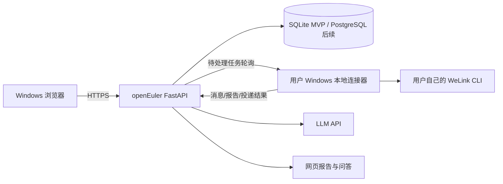

# 开源复用与 MVP 架构评审

评审日期：2026-08-06
目标：Windows 浏览器访问 openEuler 24.03 x86_64 服务器；每位用户使用自己的 WeLink 登录态；服务器统一保存配置、分析结果、审计和知识。

## 结论先行

不要把现有平台替换成一个“大而全”的开源 AI 平台。当前 FastAPI + Jinja + SQLite 已经覆盖登录、日志分析、特征库、案例库、问答、需求和 WeLink 配置，最合理的路线是：

1. **以现有项目为主干继续开发**，保持已有数据模型、权限和 Windows 浏览器体验。
2. **直接复用成熟零部件**：标准库 OAuth2 适配、编辑器组件（需要时采用 Vditor/Tiptap）、标准 Markdown/安全库、systemd timer。
3. **围绕 WeLink CLI 自研本地连接器**。公开仓库中没有找到可以证明兼容公司内部 CLI、持续维护且有可靠许可证的实现。
4. **暂不引入 Dify、Open WebUI、n8n、Celery、OpenSearch 或 Kubernetes**。它们可以作为未来独立服务，但不应成为当前业务的核心依赖。

## GitHub 项目比较

以下维护状态按 2026-08-06 GitHub 仓库元数据和 README 检查；星标数只作活跃度参考，不代表可直接使用。接入前仍应让公司法务确认许可证和内部安全要求。

| 项目 | 当前维护信号 | 部署/许可证 | 适合程度 | 判断 |
| --- | --- | --- | --- | --- |
| [Open WebUI](https://github.com/open-webui/open-webui) | 2026-08-05 有提交，约 148k stars | Docker/Python 均可；使用 Open WebUI 自定义许可并有品牌要求 | 低 | 可单独提供通用聊天，但会重复用户、会话、知识和权限；不嵌入当前核心 |
| [LibreChat](https://github.com/danny-avila/LibreChat) | 2026-08-06 有提交，约 41.7k stars | MIT；Docker Compose 和 Node/TypeScript 体系 | 中 | 若以后做独立通用 AI 门户可部署；不适合替换当前带 WeLink/日志业务的平台 |
| [Dify](https://github.com/langgenius/dify) | 2026-08-06 有提交，约 151k stars | Docker Compose 多服务；Dify Open Source License（Apache 衍生附加条件） | 低 | 适合流程编排/RAG 产品，不适合当前轻量单体 MVP；运维面明显扩大 |
| [Tiptap](https://github.com/ueberdosis/tiptap) | 2026-08-06 有提交，约 37.9k stars | MIT 核心；需要前端构建和扩展选型 | 高（组件） | 未来编辑器升级的首选；当前已有编辑器可先稳定，不必立即重写 |
| [Vditor](https://github.com/Vanessa219/vditor) | 2026-07-02 有提交，约 11.2k stars | MIT；可作为前端包直接集成，部署简单 | 高（组件） | 如果案例/工具说明继续扩展，最快替换当前 Markdown 编辑区；需重新接入安全渲染和图片存储 |
| [TOAST UI Editor](https://github.com/nhn/tui.editor) | 仓库最新提交约为 2024-08-01 | MIT；集成不难但维护信号明显弱于 Vditor/Tiptap | 低 | 新功能不建议再选；仅在已有历史项目中保守维护 |
| Python 标准库 OAuth2 适配 | 当前实现使用 `urllib`、PKCE 和受控 UserInfo 调用 | Python 标准库 | 高 | 当前华为 IDaaS 只用 OAuth2 Authorization Code；不引入 OIDC/JWT/JWKS 依赖 |
| [APScheduler](https://github.com/agronholm/apscheduler) | 2026-08-01 有提交，约 7.6k stars | MIT；Python 依赖 | 中（后续） | 可用于单进程调度；生产多 worker、重启恢复和分布式锁仍需额外设计 |
| [n8n](https://github.com/n8n-io/n8n) | 2026-08-06 有提交，约 199k stars | 多服务/Node；Sustainable Use License，不是传统 MIT/Apache 项目 | 低 | 可做外围自动化实验，不放进核心产品和公开交付包 |

### 日志平台类项目

[Graylog](https://github.com/Graylog2/graylog2-server)、[Grafana Loki](https://github.com/grafana/loki) 和 [OpenSearch](https://github.com/opensearch-project/OpenSearch) 都还在维护，但它们解决的是大规模日志采集、检索、指标和长期观测，不是“上传一份 BMC 归档 → 按硬件规则定位证据 → 生成处置建议”。它们会引入 Java/Go 服务、索引/对象存储、权限和备份体系。当前先保留本地安全解析器；当日志量、保留周期或多服务器采集达到瓶颈后，再把它们作为检索层，而不是重写问题分析业务。

### WeLink 项目检索结论

GitHub 上能找到的 [jd-smart-fe/welink-cli](https://github.com/jd-smart-fe/welink-cli) 是较早的 JavaScript 脚手架，最后活跃时间较早，不能证明与公司内部通信 CLI 兼容；另有少量近期个人仓库没有许可证、没有活跃社区或缺少完整协议。它们不能作为生产连接器依赖。WeLink CLI 的命令白名单、登录态、消息格式和发送权限必须由公司内部提供并由本项目的连接器适配。

## 应该直接用、基于现有项目改，还是自己开发？

| 能力 | 推荐方式 | 原因 |
| --- | --- | --- |
| Web 主平台、权限、台账、报告 | 基于现有项目改 | 业务上下文已经形成，替换会丢失数据关系和交互经验 |
| 华为 IDaaS | 复用现有 OAuth2 Authorization Code + PKCE 适配层 | 标准协议流程固定；只把端点、Tenant、Claim 和群组配置化 |
| 富文本/Markdown | 当前轻量实现先稳定；Vditor/Tiptap 作为后续替换候选 | 当前已覆盖表格、图片、链接、分隔线、代码块和 Windows 剪贴板粘贴；只有在需要协作评论、拖拽上传或复杂块编辑时再引入完整组件 |
| WeLink CLI | 自研 Windows 本地连接器 | 每个人登录自己的账号，公开项目没有可信兼容实现 |
| 每天定时触发 | MVP 直接用 systemd timer；后续再评估 APScheduler | 不增加常驻 worker，不会因 Uvicorn 多 worker 重复执行 |
| 通用 AI 聊天 | 现有问答继续使用；Open WebUI/LibreChat 只做独立选项 | 当前问答必须绑定台账、报告、特征和权限，不能变成无约束通用聊天 |
| 流程编排 | 先写清晰的 Python 状态机；有跨团队流程后再评估 n8n/Dify | 当前流程短且稳定，外部编排平台会增加数据和权限边界 |
| 大规模日志检索 | 先保留本地解析；规模达到阈值再接 OpenSearch/Loki | MVP 不需要集群、索引和额外运维 |

## 最简单、可上线的 MVP

### 1. 服务器只做四件事

- 账号与权限：IDaaS OAuth2 UserInfo、角色、用户级消息源/接收方隔离。
- 任务与状态：创建巡检任务、记录阶段、重试、失败原因和审计事件。
- 分析与沉淀：规则优先提取通报群字段；讨论群消息先去重、按问题聚类，再让 LLM 生成背景、进展、根因、下一步、责任人、参与者和证据引用。
- 展示与投递：网页报告、持续问答、通过连接器投递给选定群/个人。

### 2. Windows 只安装一个本地连接器

连接器作为 Windows 托盘程序或 Windows Service 安装在每位用户的电脑上，使用该用户已经登录的 WeLink CLI。浏览器不直接执行命令，也不把 CLI 账号交给服务器。



MVP 不让浏览器直接访问 `localhost` 连接器，因为这样会遇到 CORS、浏览器安全策略、连接器未安装、多个浏览器标签争抢和 Windows 防火墙问题。连接器主动通过 HTTPS 轮询服务器，网络方向简单、可审计、适合后续升级为 WebSocket。

### 3. 连接器最小协议

先实现 5 个接口，不要一开始做复杂消息总线：

```text
POST /v1/connectors/pair              一次性配对码换取设备令牌
POST /v1/inspection-runs              创建巡检任务，返回 run_id/idempotency_key
GET  /v1/connectors/jobs              连接器轮询自己的待处理任务
POST /v1/connectors/jobs/{id}/result  上传标准化消息、证据和投递结果
POST /v1/connectors/jobs/{id}/ack     确认领取/完成/失败，支持重试
```

任务必须有租约、幂等键、重试次数、心跳和取消状态。服务器永远传结构化参数，不传任意 shell 字符串；连接器只允许执行固定的 WeLink CLI 子命令。

### 4. MVP 数据最小闭环

第一版只保留这些对象：

```text
users / connector_devices / sources / recipients
inspection_runs / raw_messages / issues / issue_evidence
reports / deliveries / audit_events
```

本地 MVP 已为 `welink_issues`、证据和行动项补上分组归属：来源、接收方、运行、问题、报告和问答均按 `welink_groups` 查询，问题/行动项写操作按可见分组校验；旧数据会迁移到个人空间。上线前仍要用三个脱敏账号验证真实 IDaaS 群组映射和管理员审计。

## 当前实现需要补的关键能力

按优先级排序：

1. **P0 数据隔离**：第一版已实现；上线前用三个脱敏账号验证真实 IDaaS 群组映射、撤销和管理员审计。
2. **P0 连接器协议**：第一版已实现配对、心跳、租约、幂等、尝试次数、取消和结果回写；拿到公司 CLI 白名单后再完成 Windows 适配器和签名打包。
3. **P0 真实调度器**：已提供 `app.welink_scheduler` 和 `deploy/bmc-welink-scheduler.{service,timer}`，每分钟按分组规则创建幂等连接器任务；部署到 openEuler 后仍需启用 timer。
4. **P1 可追溯分析**：每条结论必须能回到群、作者、消息时间、原文片段和规则/模型版本；LLM 失败时保留规则结果，不生成虚假结论。
5. **P1 安全与留存**：消息正文脱敏、加密备份、保留周期、删除/导出、操作审计、连接器令牌轮换和失败告警。
6. **P1 资源边界**：先用 SQLite + 本地附件目录；并发用户、报告体积或保留周期达到阈值后迁移 PostgreSQL + 对象存储，避免在 MVP 阶段预先引入集群。
7. **P2 产品化**：模板化通报表格、收藏/订阅、问题合并、责任人提醒、周报和 SLA 趋势；这些属于验证使用价值后的增量能力。

## 服务器实现建议

### MVP 部署

```text
Nginx HTTPS
  └── FastAPI/Uvicorn（单 worker，systemd 管理）
       ├── SQLite + uploads（每日备份）
       ├── OAuth2 UserInfo/LLM 出站 HTTPS
       └── Connector job API
```

单台 x86 openEuler 服务器先保持单 worker，避免 SQLite 写锁和定时任务重复；流式接口通过 Nginx 关闭缓冲。连接器与 LLM 的长任务都采用异步任务状态，不在浏览器请求中等待完整分析。

### 何时升级

- 多台应用节点或并发写入明显增加：迁移 PostgreSQL，并使用数据库租约/队列。
- 单日数万条消息、需要全文检索和多年留存：引入 OpenSearch/Loki 作为检索层，原始正文放受控对象存储。
- 跨团队审批、定时流程超过十类：再评估 APScheduler/Celery/n8n/Dify；届时要单独设计权限、队列和许可证边界。

## 需要主动修正的产品思维

硬件工程师思维的优势是重视证据、状态和闭环，这正是本项目的核心；需要补充的不是更多按钮，而是：

- 先定义用户/团队边界，再定义页面；
- 先定义失败、重试、超时、重复执行，再定义“一键开始”；
- 让每个 AI 结论都有证据和置信度，禁止“看起来很完整”的无来源总结；
- 把连接器、模型、规则、报告投递都做成可替换适配器；
- 用 3 个脱敏账号、3 类日志、1 个测试群完成真实闭环后，再扩展功能。

**最终建议：基于现有项目改 + 直接复用标准组件 + 自研 WeLink 连接器。** 这是当前风险最低、部署最简单、也最符合公司内部迁移条件的方案。
